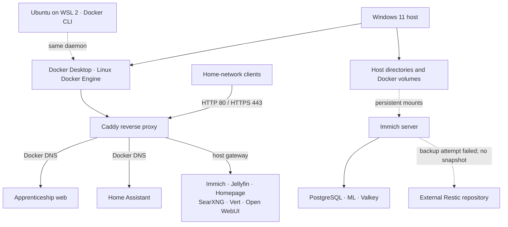

# Self-Hosted Infrastructure Lab

> **A student-built infrastructure portfolio exploring containerisation, networking, service operations, security and data protection.**

This repository documents a practical home-lab that I build, operate and investigate alongside my studies. It is a record of hands-on learning: deploying services, understanding how they communicate, reviewing how data is stored, diagnosing problems and turning the results into clear technical documentation.

The portfolio is intended to demonstrate practical skills relevant to **IT infrastructure, systems administration, networking, DevOps and cybersecurity**. It is not presented as an enterprise production environment. Findings are evidence-based, limitations are recorded, and unfinished work is labelled honestly.

---

## At a glance

| Area | Current environment |
|---|---|
| Host platform | Windows 11 |
| Container platform | Docker Desktop with the WSL 2 backend |
| Linux environment | Ubuntu on WSL 2 |
| Container engine | Docker Engine, Linux containers |
| Reverse proxy | Caddy |
| Application deployment | Docker Compose and standalone containers |
| Data protection | Immich database dumps; Restic repository initialised, but no completed snapshot exists yet |
| Documentation | Markdown, command-line evidence and Mermaid diagrams |

The current inventory documents **16 running containers** across application, infrastructure and supporting services. Versions and operational details are point-in-time observations and should be refreshed as the lab changes.

## Architecture at a glance

The full host, service and storage relationships are documented in the [Architecture Overview](docs/architecture-overview.md).

## What the lab contains

The environment brings together several self-hosted services and the infrastructure that supports them.

| Area | Examples | What I am documenting |
|---|---|---|
| Reverse proxy | Caddy | Host-based routing, TLS and upstream connectivity |
| Photos and media management | Immich | Application components, database, media storage and backup approach |
| Home automation | Home Assistant | Container deployment and configuration persistence |
| Media services | Jellyfin | Application storage and service access |
| Search and dashboard | SearXNG, Homepage | Deployment, routing and dependencies |
| File conversion | Vert | Container operation and access path |
| AI interface | Open WebUI | Application deployment and supporting configuration |
| DNS services | Pi-hole, Unbound | DNS flow, upstream configuration and persistence risks |
| Remote access | Twingate Connector | Role of the connector and its operational dependencies |
| Application development | Apprenticeship Tracker | Separate web and API containers, networking and data storage |

This table describes the documented scope, not a recommendation to expose every service beyond the home network.

## Skills demonstrated

### Infrastructure and systems

- Operating a Windows-based host running Linux containers through Docker Desktop and WSL 2.
- Inspecting containers, images, volumes, mounts, restart behaviour and health checks.
- Understanding the difference between a Docker client in WSL and the Docker daemon it controls.
- Reviewing Docker Compose projects and identifying services whose deployment definitions need to be recovered or documented.

### Networking and service connectivity

- Mapping Docker bridge networks and container membership.
- Reviewing published ports and the distinction between host-published and container-internal ports.
- Tracing Caddy reverse-proxy routes to Docker service names and host-published endpoints.
- Investigating DNS configuration and upstream relationships between Pi-hole and Unbound.

### Security and reliability

- Reviewing Windows Defender Firewall profiles, inbound defaults and application-specific allow rules.
- Identifying broad firewall exceptions, stale rules and services that need further security review.
- Checking container users, privileges, mounts and access to the Docker socket.
- Identifying persistent data that is stored in a container's writable layer rather than in a mounted volume.

### Backup, recovery and documentation

- Reviewing Immich media storage and PostgreSQL backup artefacts.
- Initialising an encrypted Restic repository on external storage and completing a successful backup dry run using Windows Volume Shadow Copy.
- Investigating a failed full-backup attempt using Windows Disk and NTFS event logs; the Restic repository check passed but contained zero completed snapshots.
- Recording the difference between a successful dry run, a repository integrity check, a completed backup and a tested restore.
- Producing architecture diagrams, inventories, operational notes and evidence-linked findings.

## Selected engineering investigations

These examples show the kind of work recorded in this repository. They are deliberately written as investigations rather than claims of completed remediation.

### Mapping a reverse-proxy environment

I inspected the Caddy site definitions, Docker network membership and published ports to map application routes. This identified services using Docker DNS directly and others reached through the Docker Desktop host gateway. I also checked Caddy's configuration validity and used its logs to investigate upstream failures.

**Outcome:** a documented route and dependency map, with unresolved or maintenance-related behaviour distinguished from confirmed configuration faults.

### Finding a persistence risk in DNS infrastructure

Inspection of the Pi-hole container showed that it had no mounted persistent volumes. Its live configuration and database files were present in the container's writable layer.

**Outcome:** a concrete recovery risk was identified. The configuration must be exported and verified before the container is recreated or replaced.

### Preparing an external Immich backup

I measured the media and application data, reviewed the existing PostgreSQL dump files, initialised an encrypted Restic repository on an external drive and completed a Volume Shadow Copy dry run. The dry run scanned the selected data successfully, but it did not create a backup snapshot. The first full write attempt is covered in the incident case study below.

### Auditing host firewall policy

I checked the active Windows network profile and effective firewall defaults, then inspected relevant inbound rules. The default inbound action is Block across the Domain, Private and Public profiles. The review also identified broad HTTP/HTTPS, Docker Desktop Backend and AnyDesk exceptions, plus obsolete Nextcloud rules.

**Outcome:** the current policy and review candidates are documented. No firewall rules were changed as part of the read-only audit.

### Investigating an interrupted external backup

I correlated a Restic write failure with Windows Disk 153, Disk 51 and NTFS 50 events, then checked the external volume with CHKDSK and verified the Restic repository. The filesystem scan and repository integrity check passed, but the repository contained zero completed snapshots. The case study records the evidence and the remaining recovery checks without claiming the backup is operational.

## Repository guide

| Document | What it covers |
|---|---|
| [Current state](docs/current-state.md) | Host, Windows, WSL 2 and Docker baseline |
| [Architecture overview](docs/architecture-overview.md) | How the host, Docker runtime, applications, networking and storage fit together |
| [Container inventory](docs/container-inventory.md) | Container images, published ports, health and persistence |
| [Networking and routing](docs/networking.md) | Docker networks, Caddy routes, DNS and published ports |
| [Security baseline](docs/security-baseline.md) | Observed firewall and container security findings |
| [Backup and recovery](docs/backup-and-recovery.md) | Immich data, database dumps and Restic status |
| [Immich backup incident](docs/case-studies/immich-backup-incident.md) | Evidence-led investigation of the failed external backup |
| [Known gaps and actions](docs/known-gaps-and-actions.md) | Outstanding checks and evidence-backed priorities |
| [Evidence and method](docs/evidence-and-method.md) | Discovery methods, confidence labels and limitations |
| [Architecture diagram](diagrams/current-architecture.mmd) | Mermaid view of the documented environment |
| [Docker network topology](diagrams/docker-network-topology.mmd) | Observed container membership across Docker networks |
| [Security policy](SECURITY.md) | Safe disclosure and vulnerability-reporting guidance |

## How the documentation is maintained

I use a simple evidence standard so that the repository separates facts from assumptions:

- **Verified:** directly supported by command output or an inspected configuration file.
- **Inferred:** a reasonable interpretation of verified evidence, but not directly demonstrated.
- **Open:** needs another check or confirmation.
- **Deferred:** intentionally not investigated in the current documentation scope.

The audit is primarily read-only. A finding is not treated as permission to change a running service. Proposed changes should include their impact, dependencies, backup requirements and rollback method before implementation.

## Current focus

The current objective is to finish the technical documentation and make the public portfolio useful to another engineer or prospective employer. Work is focused on accurate architecture, service-level documentation, deployment reproducibility, security observations and data-protection evidence.

This repository documents the existing Windows and Docker environment as a practical learning and engineering portfolio.

## Privacy and publication

This is intended to be a public portfolio, so operational details are sanitised. The repository must not contain:

- passwords, API tokens, access keys or `.env` files;
- private keys, private certificates or database credentials;
- personal usernames, private filesystem paths or identifying hostnames;
- private IP ranges, internal DNS records or screenshots that expose sensitive network details unless deliberately reviewed and anonymised;
- unredacted logs containing cookies, session identifiers or personal information.

Configuration examples should be sanitised and labelled as examples. They should not be assumed to be exact copies of the live deployment.

## About this project

I am a student building practical experience across infrastructure, systems, networking, DevOps and security. This lab gives me a place to apply concepts, investigate real operational behaviour and document what I learn in a way that can be reviewed and reproduced where appropriate.

The most important part of the project is not the number of containers. It is the engineering process behind them: **understand the system, collect evidence, identify risk, explain decisions and verify outcomes.**

---

**Last reviewed:** 1 November 2026  
**Project status:** Active documentation and audit
