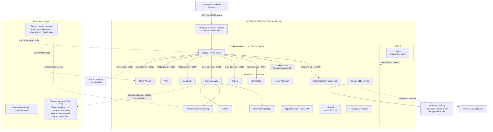

# Architecture Overview

**Snapshot date:** 1 November 2026  
**Scope:** Current Windows 11 and Docker Desktop environment; one separately deferred project is excluded.

## Purpose

This page explains how the documented services are hosted, how requests reach them, how Docker networking is arranged, and where important application data is stored. It describes the observed environment, not a target design.

## Architecture diagram

GitHub renders the Mermaid diagram below. The editable source is also available at [`diagrams/current-architecture.mmd`](../diagrams/current-architecture.mmd).

## 1. Host and container runtime

The current environment has three relevant layers:

| Layer | Observed component | Role |
|---|---|---|
| Physical host | HP Elite Mini 800 G9 | Runs Windows and the local infrastructure workload |
| Host operating system | Windows 11 | Owns the physical network interfaces, host firewall and NTFS-backed application directories |
| Container platform | Docker Desktop 4.95.0 | Provides the Linux container environment and Docker Engine 29.8.2 |
| Linux workspace | Ubuntu on WSL 2 | Provides a Linux command-line workspace and Docker CLI; it connects to the same Docker Desktop daemon as the Windows CLI |

Ubuntu WSL is not a second independent Docker host in this setup. The Docker server ID reported by the Windows and Ubuntu clients matched during discovery.

## 2. Request and service flow

Caddy provides the HTTP/HTTPS reverse-proxy entry point; exact host-published port details are omitted.

Two configured routes use Docker service-name resolution on `[DOCKER_NETWORK_1]`:

- Apprenticeship Tracker web: `web:80`
- Home Assistant: `homeassistant:8123`

The other identified Caddy routes use `[DOCKER_HOST_GATEWAY_ALIAS]` and a host-published port:

| Application route label | Configured upstream | Identified destination |
|---|---|---|
| Dashboard | `[DOCKER_HOST_GATEWAY_ALIAS]:3001` | Homepage |
| Movies | `[DOCKER_HOST_GATEWAY_ALIAS]:8096` | Jellyfin |
| Photos | `[DOCKER_HOST_GATEWAY_ALIAS]:2283` | Immich server |
| Search | `[DOCKER_HOST_GATEWAY_ALIAS]:8080` | SearXNG |
| Vert | `[DOCKER_HOST_GATEWAY_ALIAS]:3005` | Vert |
| Ollama | `[DOCKER_HOST_GATEWAY_ALIAS]:3000` | Open WebUI host port in the captured inventory; this route name does not establish that it serves the Ollama API |
| Kali | `[DOCKER_HOST_GATEWAY_ALIAS]:8088` | Unresolved; no matching Windows listener or published container port was found during the check |

Caddy configuration validation passed. That confirms the configuration can be parsed and adapted; it does not prove that every upstream is reachable at all times.

The user confirmed that the logged Immich 502 responses occurred during an intentional Immich image update. They are recorded as maintenance-related downtime, not as a persistent route fault.

## 3. Application groups

### Immich

The observed Immich application group contains:

- `[CONTAINER_ROLE_IMMICH]`, the application server;
- `[CONTAINER_ROLE_DATABASE]`, the PostgreSQL database;
- `[CONTAINER_ROLE_PROCESSOR]`, the machine-learning service;
- `[CONTAINER_ROLE_CACHE]`, which uses the Valkey image in the captured inventory.

These containers share `[DOCKER_NETWORK_2]`. Caddy and Homepage also join that network. The configured Caddy photos route currently uses the host-published Immich port rather than the direct Docker network address.

### Apprenticeship Tracker

The observed project has separate web and API containers. The web container shares `[DOCKER_NETWORK_1]` with Caddy and is configured as the direct `web:80` upstream. The API publishes host port 4000. The API and web containers are also members of the project's default network.

### Other services

The repository documents several application services; historical per-service routes and published-port mappings are omitted.

The historical DNS upstream and Docker-network relationship is omitted.

The Twingate Connector provides remote-access connectivity; historical container network mode is omitted.

## Historical Docker network topology details omitted## 5. Persistent data and storage

Application state uses persistent storage; historic per-service host mount details are omitted.

| Workload | Observed storage pattern | Documentation concern |
|---|---|---|
| [SERVICE ROLE] | [HISTORICAL STORAGE TOPOLOGY OMITTED] | [OPERATIONAL DETAILS GENERALISED] |
| [SERVICE ROLE] | [HISTORICAL STORAGE TOPOLOGY OMITTED] | [OPERATIONAL DETAILS GENERALISED] |
| [SERVICE ROLE] | [HISTORICAL STORAGE TOPOLOGY OMITTED] | [OPERATIONAL DETAILS GENERALISED] |
| Immich machine learning | Docker named volume | Model cache rather than primary user media |
| [SERVICE ROLE] | [HISTORICAL STORAGE TOPOLOGY OMITTED] | [OPERATIONAL DETAILS GENERALISED] |
| [SERVICE ROLE] | [HISTORICAL STORAGE TOPOLOGY OMITTED] | [OPERATIONAL DETAILS GENERALISED] |
| Open WebUI | Docker named volume at `/app/backend/data` | Preserve application data volume |
| [SERVICE ROLE] | [HISTORICAL STORAGE TOPOLOGY OMITTED] | [OPERATIONAL DETAILS GENERALISED] |

The external Restic repository was initialised on a Seagate USB drive. The first full backup attempt failed during writes with Windows disk and NTFS errors. Restic later reported zero completed snapshots and its repository integrity check found no structural errors. The repository is **not a completed backup** and must not be represented as a verified recovery copy.

## Historical host-port and firewall-boundary details omitted## 7. Diagram legend and limitations

- **Solid arrows** represent a configured route or an observed service relationship documented from configuration/inventory.
- **Dashed arrows** represent unresolved or unverified relationships.
- The network topology diagram records container membership, not application traffic.
- The diagram intentionally omits internal IP addresses, private hostnames, credentials and certificate material.
- The architecture is a point-in-time view. It should be refreshed when containers, Compose definitions, ports, networks or storage mounts change.

## Related documentation

- [Container Inventory](container-inventory.md)
- [Networking and Routing](networking.md)
- [Backup and Recovery](backup-and-recovery.md)
- [Security Baseline](security-baseline.md)
- [Evidence and Method](evidence-and-method.md)
