# Architecture Overview

**Snapshot date:** 1 November 2026  
**Scope:** Current Windows 11 and Docker Desktop environment.

## Purpose

This page explains how the documented services are hosted, how local and remote requests reach them, how Docker networking is arranged, and where important application data is stored. It describes the observed environment, not a target design.

## Architecture diagram

GitHub renders the Mermaid diagram below. The editable source is also available at [`diagrams/current-architecture.mmd`](../diagrams/current-architecture.mmd).

```mermaid
flowchart TB
    subgraph REMOTE["Remote access outside the home"]
        REMOTE_DEVICE["Remote device"]
        TW_CLIENT["Twingate client"]
        WIFI_CLIENT["WiFiman client - Teleport VPN"]
    end

    subgraph HOME_NET["Home network - UniFi"]
        UGW["UniFi Gateway - local DNS and LAN routing"]
        LAN_CLIENT["Home network clients"]
        SWITCH["UniFi switch and access points"]
        HOME_SERVICES["Any service on the home network"]
    end

    subgraph HOST["HP Elite Mini 800 G9 - Windows 11 host"]
        FW["Windows Defender Firewall"]

        subgraph WSL["WSL 2"]
            UBUNTU["Ubuntu - Docker CLI client"]
        end

        subgraph DOCKER["Docker Desktop - Linux Docker Engine"]
    CADDY["Caddy reverse proxy"]
    TWIN["Twingate Connector"]
            subgraph APPGROUPS["Application containers"]
                WEB["Apprenticeship Tracker web"]
                HA["Home Assistant"]
                JELLY["Jellyfin"]
                HOMEPAGE["Homepage"]
                IMMICH["Immich server"]
                PG["Immich PostgreSQL"]
                ML["Immich machine learning"]
                VALKEY["Valkey"]
                SEARCH["SearXNG"]
                VERT["Vert"]
                WEBUI["Open WebUI"]
                API["Apprenticeship Tracker API"]
                PI["Pi-hole"]
                UNBOUND["Unbound"]
                KALI["Kali route target - unresolved"]
            end
        end
    end

    LAN_CLIENT -->|Local DNS query| UGW
    UGW -.->|Local hostname resolves to host LAN address| LAN_CLIENT
    LAN_CLIENT --> SWITCH
    SWITCH -->|HTTP or HTTPS request| FW
    FW --> CADDY

    REMOTE_DEVICE --> TW_CLIENT
    TW_CLIENT -->|Private access connection| TWIN
    TWIN -->|User-confirmed access to any home-network service| HOME_SERVICES

    REMOTE_DEVICE --> WIFI_CLIENT
    WIFI_CLIENT -->|Teleport VPN connection| UGW
    UGW -->|Permitted VPN access| FW

    UBUNTU -.->|Docker CLI uses same daemon| DOCKER
    %% Historical Caddy upstream and port mapping omitted
    %% Historical Caddy upstream and port mapping omitted
    %% Historical Caddy upstream and port mapping omitted
    %% Historical Caddy upstream and port mapping omitted
    %% Historical Caddy upstream and port mapping omitted
    %% Historical Caddy upstream and port mapping omitted
    %% Historical Caddy upstream and port mapping omitted
    %% Historical Caddy upstream and port mapping omitted
    %% Historical Caddy upstream and port mapping omitted
    IMMICH --> PG
    IMMICH --> ML
    IMMICH --> VALKEY

    subgraph STORAGE["Persistent storage"]
    HOSTDATA["Host storage (mount details omitted)"]
        VOLUMES["Docker named volumes"]
        RESTIC["External encrypted Restic repository"]
        SNAPSHOT["Successful initial snapshot 7ec7a616"]
    end
    %% Historical host-mount relationship omitted
    %% Historical host-mount relationship omitted
    VOLUMES -.->|Model cache| ML
    VOLUMES -.->|Application data| WEBUI
    VOLUMES -.->|Caddy state| CADDY
    %% Historical host-mount relationship omitted
    %% Historical host-mount relationship omitted
    %% Historical host-mount relationship omitted

    IMMICH -->|Initial backup completed successfully| RESTIC
    RESTIC -->|48,335 files - 197.721 GiB scanned| SNAPSHOT
    SNAPSHOT -.->|Restore test outstanding| RESTORE["Recovery verification"]

    PI -.->|Configured upstreams| PUBLIC_DNS["Public DNS upstreams"]
    PI --- UNBOUND_NOTE["Unbound runs separately and is not configured as Pi-hole upstream"]

    classDef pending stroke-dasharray: 5 5;
    class KALI,RESTORE pending;
```

## 1. Host and container runtime

The current environment has three relevant layers:

| Layer | Observed component | Role |
|---|---|---|
| Physical host | HP Elite Mini 800 G9 | Runs Windows and the local infrastructure workload |
| Host operating system | Windows 11 | Owns the physical network interfaces, host firewall and NTFS-backed application directories |
| Container platform | Docker Desktop 4.95.0 | Provides the Linux container environment and Docker Engine 29.8.2 |
| Linux workspace | Ubuntu on WSL 2 | Provides a Linux command-line workspace and Docker CLI; it connects to the same Docker Desktop daemon as the Windows CLI |

The Windows Docker CLI and Ubuntu WSL Docker CLI were both observed to communicate with the same Docker Desktop daemon. The Docker server ID matched in both environments. Ubuntu WSL is therefore a client/workspace for the same engine, not a second independent Docker host.

## 2. Local DNS and application routing

The home network uses the UniFi Gateway to manage local DNS records and hostnames, as well as LAN routing.

The request path for a local web service is:

1. A home-network client asks UniFi DNS to resolve the local hostname.
2. UniFi returns the configured address, which points to the Windows host in the documented web-service design.
3. The client sends its HTTP or HTTPS request to the host.
Caddy receives the HTTP/HTTPS request.
5. Caddy selects the configured upstream and forwards the request to the relevant application.

The responsibilities are distinct:

- **UniFi Gateway:** local DNS resolution, hostnames and LAN routing.
- **Caddy:** application-level HTTP and HTTPS reverse-proxy routing.

UniFi resolves the name; Caddy selects the application.

## 3. Remote access

Two independent options are used for remote access from outside the home network.

### Twingate

The Twingate Connector runs as a Docker container using host networking. The user has confirmed that Twingate provides remote access to **any service on the home network**.

The architecture therefore treats Twingate as a general remote-access path to home-network services, rather than limiting it to the services behind Caddy.

### UniFi Teleport

UniFi Teleport provides a separate VPN access option through the WiFiman client. A remote device connects to the UniFi Gateway and receives access to the home network according to the configured network policies.

Twingate and UniFi Teleport are independent options. They do not need to be active together for a remote session.

## 4. Caddy request and service flow

Caddy provides the HTTP/HTTPS reverse-proxy entry point; exact host-published port details are omitted.

Two configured routes use Docker service-name resolution on `[DOCKER_NETWORK_1]`:

- Apprenticeship Tracker web: `web:80`
- Home Assistant: `homeassistant:8123`

The other identified Caddy routes use `[DOCKER_HOST_GATEWAY_ALIAS]` and a host-published port:

| Application route label | Configured upstream | Identified destination |
|---|---|---|
| Dashboard | `[DOCKER_HOST_GATEWAY_ALIAS]:3001` | Homepage |
| Movies | `[DOCKER_HOST_GATEWAY_ALIAS]:8096` | Jellyfin |
| Photos | `[DOCKER_HOST_GATEWAY_ALIAS]:2283` | Immich server |
| Search | `[DOCKER_HOST_GATEWAY_ALIAS]:8080` | SearXNG |
| Vert | `[DOCKER_HOST_GATEWAY_ALIAS]:3005` | Vert |
| Ollama | `[DOCKER_HOST_GATEWAY_ALIAS]:3000` | Open WebUI host port in the captured inventory; this route name does not establish that it serves the Ollama API |
| Kali | `[DOCKER_HOST_GATEWAY_ALIAS]:8088` | Unresolved; no matching Windows listener or published container port was found during the check |

Caddy configuration validation passed. This confirms that the configuration can be parsed and adapted; it does not prove that every upstream is reachable at all times.

The historical Immich 502 responses were explained by the user as expected errors during an intentional Immich image update. They are recorded as maintenance-related downtime, not as a persistent route fault.

## 5. Application groups

### Immich

The observed Immich application group contains:

- `[CONTAINER_ROLE_IMMICH]`, the application server;
- `[CONTAINER_ROLE_DATABASE]`, the PostgreSQL database;
- `[CONTAINER_ROLE_PROCESSOR]`, the machine-learning service;
- `[CONTAINER_ROLE_CACHE]`, which uses the Valkey image in the captured inventory.

These containers share `[DOCKER_NETWORK_2]`. Caddy and Homepage also join that network. The configured Caddy photos route currently uses the host-published Immich port rather than the direct Docker network address.

### Apprenticeship Tracker

The observed project has separate web and API containers. The web container shares `[DOCKER_NETWORK_1]` with Caddy and is configured as the direct `web:80` upstream. The API publishes host port 4000. The API and web containers are also members of the project's default network.

### Other services

Home Assistant, Jellyfin, SearXNG, Homepage, Vert and Open WebUI are separately inventoried services.

The historical DNS upstream and Docker-network relationship is omitted.

## Historical Docker network topology details omitted## 7. Persistent data and storage

Application state uses persistent storage; historic per-service host mount details are omitted.

| Workload | Observed storage pattern | Documentation concern |
|---|---|---|
| [SERVICE ROLE] | [HISTORICAL STORAGE TOPOLOGY OMITTED] | [OPERATIONAL DETAILS GENERALISED] |
| [SERVICE ROLE] | [HISTORICAL STORAGE TOPOLOGY OMITTED] | [OPERATIONAL DETAILS GENERALISED] |
| [SERVICE ROLE] | [HISTORICAL STORAGE TOPOLOGY OMITTED] | [OPERATIONAL DETAILS GENERALISED] |
| Immich machine learning | Docker named volume | Model cache rather than primary user media |
| [SERVICE ROLE] | [HISTORICAL STORAGE TOPOLOGY OMITTED] | [OPERATIONAL DETAILS GENERALISED] |
| [SERVICE ROLE] | [HISTORICAL STORAGE TOPOLOGY OMITTED] | [OPERATIONAL DETAILS GENERALISED] |
| Open WebUI | Docker named volume at `/app/backend/data` | Preserve application data volume |
| [SERVICE ROLE] | [HISTORICAL STORAGE TOPOLOGY OMITTED] | [OPERATIONAL DETAILS GENERALISED] |

## 8. Immich backup status

An initial full Restic backup completed successfully on 1 November 2026.

| Metric | Result |
|---|---:|
| Repository ID prefix | `[PRIVATE_RESTIC_REPOSITORY_IDENTIFIER]` |
| Snapshot ID | `7ec7a616` |
| Files processed | 48,335 |
| Data scanned | 197.721 GiB |
| Data added to repository | 136.272 GiB |
| Data stored | 135.725 GiB |
| Duration | 3 hours, 47 minutes, 13 seconds |
| VSS source snapshot for `C:\` | Successful |
| Restic exit code | 0 |

The earlier Restic attempt failed during writes to the external drive and was investigated separately. The later successful run demonstrates that a complete initial snapshot was subsequently saved. The cause of the earlier I/O interruption has not been conclusively identified.

A post-backup repository check, inspection of snapshot contents and a sample restore test remain outstanding. The initial snapshot is a successful backup, but the complete recovery process has not yet been demonstrated.

## Historical host-port and firewall-boundary details omitted## 10. Diagram legend and limitations

- Solid arrows represent a configured route or an observed service relationship documented from configuration, inventory or operator confirmation.
- Dashed arrows represent unresolved or pending verification.
- The network topology diagram records container membership, not application traffic.
- The diagram intentionally omits internal IP addresses, private hostnames, credentials and certificate material.
- The architecture is a point-in-time view. Refresh it when containers, Compose definitions, ports, networks or storage mounts change.

## Related documentation

- [Container Inventory](container-inventory.md)
- [Networking and Routing](networking.md)
- [Backup and Recovery](backup-and-recovery.md)
- [Security Baseline](security-baseline.md)
- [Evidence and Method](evidence-and-method.md)
