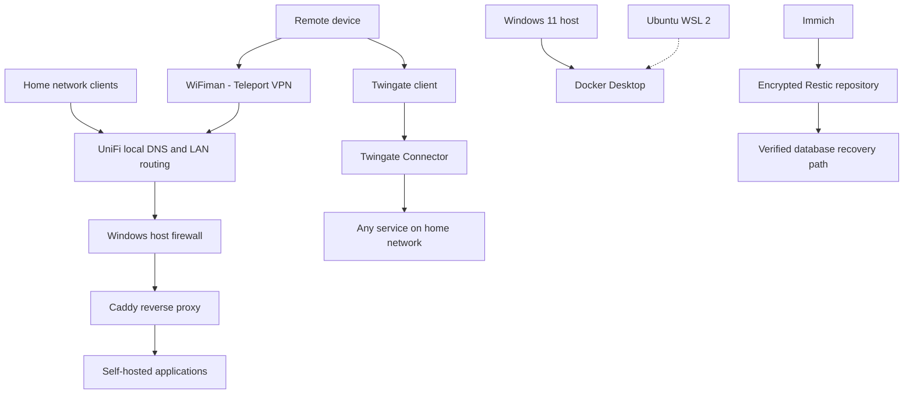

# Architecture Overview

**Last updated:** 2 November 2026  
**Scope:** Windows host, Docker Desktop, WSL 2, home networking and persistent application data.

## 1. Purpose

This document describes the current infrastructure architecture and how its components interact.

It covers:

- Physical host and operating system.
- Docker Desktop and WSL 2.
- Local DNS and application routing.
- Remote connectivity.
- Application services and Docker networks.
- Persistent data and external backups.

The diagram describes the observed environment, not a proposed future design.

## 2. High-level architecture

The infrastructure has four principal layers:

| Layer | Components | Responsibility |
|---|---|---|
| Home network | UniFi Gateway, switches and access points | Local DNS, hostname resolution and LAN routing |
| Host | HP Elite Mini 800 G9, Windows 11 | Physical compute, host firewall and storage |
| Container platform | Docker Desktop, Linux Docker Engine, WSL 2 | Runs application and infrastructure containers |
| Remote access | Twingate and UniFi Teleport | Allows remote connectivity to home-network services |

## 3. Architecture flow

The Twingate connection represents operator-confirmed access to any service on the home network. UniFi Teleport is a separate VPN option.

## 4. Host and container runtime

The host is an HP Elite Mini 800 G9 running Windows 11.

The container platform is Docker Desktop 4.95.0 with Docker Engine 29.8.2, using the Linux/amd64 environment.

Ubuntu runs under WSL 2 and provides a Linux command-line workspace.

The Windows Docker CLI and Ubuntu WSL Docker CLI were observed communicating with the same Docker Desktop daemon. The matching Docker server ID established that Ubuntu WSL is a client environment for that daemon, not a second independent Docker host.

## 5. Local DNS and routing

The home network uses the UniFi Gateway for local DNS records, hostname resolution and LAN routing.

The local web request flow is:

1. A client requests resolution of a local hostname.
2. The UniFi Gateway resolves the configured local record.
3. The hostname resolves to the relevant host LAN address.
4. The client sends an HTTP or HTTPS request.
5. Caddy receives the request on the Windows host's published ports 80 or 443.
6. Caddy forwards it to the configured application upstream.

The responsibilities are distinct:

- **UniFi:** DNS and network routing.
- **Caddy:** HTTP/HTTPS reverse proxy and application-level routing.
- **Docker:** Container execution and internal networking.

The actual local hostname values and LAN addresses are omitted from this portfolio.

## 6. Remote access architecture

Two independent methods provide remote connectivity.

### Twingate

The Twingate Connector provides remote-access connectivity; historical container network mode is omitted.

The operator has confirmed that Twingate provides access to any service on the home network.

This is documented as a user-confirmed capability. Connector credentials, tokens and private configuration are excluded from the repository.

### UniFi Teleport

UniFi Teleport provides an alternative remote VPN connection through the WiFiman client.

The remote device establishes a Teleport connection to the UniFi Gateway. Network access then follows the gateway's configured policies.

Twingate and Teleport are independent remote-access methods.

## 7. Caddy reverse proxy

Caddy is the primary HTTP/HTTPS reverse proxy.

The main configuration imports site-specific Caddy snippets. The observed configuration includes routes to:

| Application | Configured upstream |
|---|---|
| Apprenticeship Tracker web | `web:80` |
| Home Assistant | `homeassistant:8123` |
| Homepage | `[DOCKER_HOST_GATEWAY_ALIAS]:3001` |
| Jellyfin | `[DOCKER_HOST_GATEWAY_ALIAS]:8096` |
| Immich | `[DOCKER_HOST_GATEWAY_ALIAS]:2283` |
| SearXNG | `[DOCKER_HOST_GATEWAY_ALIAS]:8080` |
| Vert | `[DOCKER_HOST_GATEWAY_ALIAS]:3005` |
| Open WebUI | `[DOCKER_HOST_GATEWAY_ALIAS]:3000` |
| Kali route | `[DOCKER_HOST_GATEWAY_ALIAS]:8088`, unresolved |

The Caddy configuration passed validation. Validation confirms that the configuration can be parsed and adapted. It does not establish that every upstream is reachable at every moment.

The `ollama` site snippet currently points to the Open WebUI host-published port in the captured inventory. Its route label alone does not establish that it serves the Ollama API.

## 8. Application architecture

### Immich

The Immich application group contains:

- Immich server.
- PostgreSQL database.
- Machine-learning service.
- Valkey cache service.

The containers share the Immich Docker network.

The original photo/video library and managed media are stored in host-backed directories. PostgreSQL uses a separate host-backed data directory.

### Apprenticeship Tracker

The project has separate web and API containers.

The application has separate web and API components; exact network membership and host-port details are omitted.

### Other services

The wider service environment includes:

- Home Assistant.
- Jellyfin.
- Homepage.
- SearXNG.
- Vert.
- Open WebUI.
- Pi-hole.
- Unbound.
- Twingate Connector.
- VEMS and other application workloads.

## Historical Docker network topology details omitted## 10. Persistent storage and backup architecture

The environment uses both Windows bind mounts and Docker named volumes.

Important storage patterns include:
- [Historical per-service storage and persistence details omitted.]
- Immich managed media: host-backed directory.
- PostgreSQL: separate host-backed database directory.
- Immich machine-learning model cache: Docker named volume.
- Open WebUI application data: Docker named volume.
- [Historical per-service storage and persistence details omitted.]
- Home Assistant configuration: host directory.
- Pi-hole: no Docker mounts observed during the audit.

The Pi-hole configuration and database files therefore require special care before container recreation.

### Restic backup

The Immich backup process uses Restic 0.19.1 and an encrypted repository on an external Seagate drive.

Two snapshots were confirmed:

| Snapshot | Purpose |
|---|---|
| `7ec7a616` | Initial full backup |
| `e8d1bd6a` | Subsequent daily backup |

The initial backup processed 48,335 files and 197.721 GiB. It stored 135.725 GiB in the repository.

A database dump was successfully restored from the repository, compared against its original SHA-256 hash, and imported into an isolated PostgreSQL 14 instance.

A complete Immich application restore has not yet been performed.

## 11. Outstanding architecture concerns

The following matters remain open:

- Pi-hole's active upstreams point to public DNS rather than the separately running Unbound service.
- Pi-hole has no persistent Docker mounts.
- A Kali-labelled Caddy upstream remains unresolved.
- The Open WebUI upstream is labelled `ollama` in Caddy.
- Several containers publish ports on all host interfaces.
- Complete application recovery has not been demonstrated.
- External storage reliability needs continued observation following the earlier I/O interruption.

## 12. Diagram and evidence conventions

- Solid arrows represent observed configurations or confirmed relationships.
- Dashed arrows represent unresolved or pending relationships.
- Operator-confirmed facts are identified explicitly.
- Network membership does not prove actual application traffic.
- Private hostnames, IP addresses, credentials and certificate contents are excluded.

## Related documentation

- [Container Inventory](container-inventory.md)
- [Networking and Routing](networking.md)
- [Backup and Recovery](backup-and-recovery.md)
- [Security Baseline](security-baseline.md)
- [Known Gaps and Actions](known-gaps-and-actions.md)
- [Evidence and Method](evidence-and-method.md)
